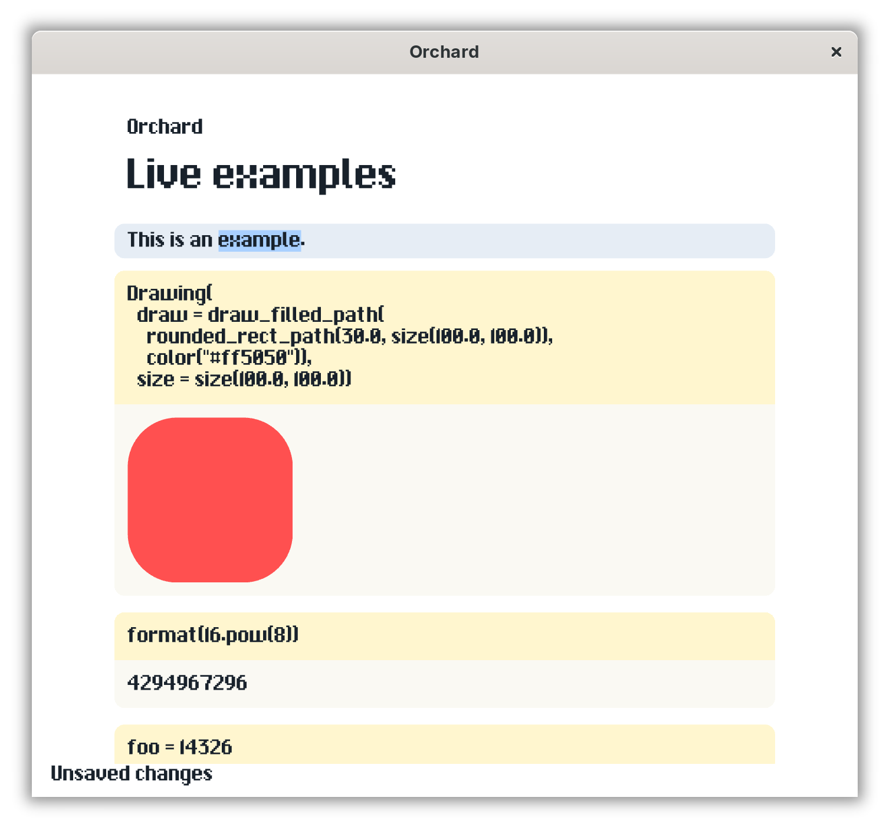

# Orchard

Hi!
This repository contains Orchard, a live notebook.
Orchard stands for "Orchard, a recursive computing habitat for art, research, and development".

To run the notebook provided with this repo, run:

```
zig build run -- notebook.orchard
```

This will start a window, where you see the notebook.
If you edit code cells, you'll see that they immediately show their result below.



## A guide to this repo

[vm/](vm/) contains the virtual machine.
I recommend first looking at how objects are stored in an immutable heap ([heap.zig](vm/heap.zig)).
Code running in the VM is actually just a tree of objects that represents a computation.
There's a tree walking interpreter ([vm_tree_walk.zig](vm/vm_tree_walk.zig)), a byte code interpreter ([vm_byte_code.zig](vm/vm_byte_code.zig)), and a JIT compiler ([vm_x86_64.zig](vm/vm_x86_64.zig)).
The VM only understands low-level operations.
Using those low-level operations, I created a compiler for a slightly higher-level language ([bootstrap.objects](vm/bootstrap.objects)) I call Olive (Optimizable Lisp Implementing Various Expressions).
In Olive, I created another compiler that can optimize code, compile (and optimize) itself, and compile notebooks ([bootstrap.olive](vm/bootstrap.olive)).
When you `zig build` the project for the first time, this bootstrapping process takes place and produces an optimizing notebook compiler that is then baked into the final orchard executable.
